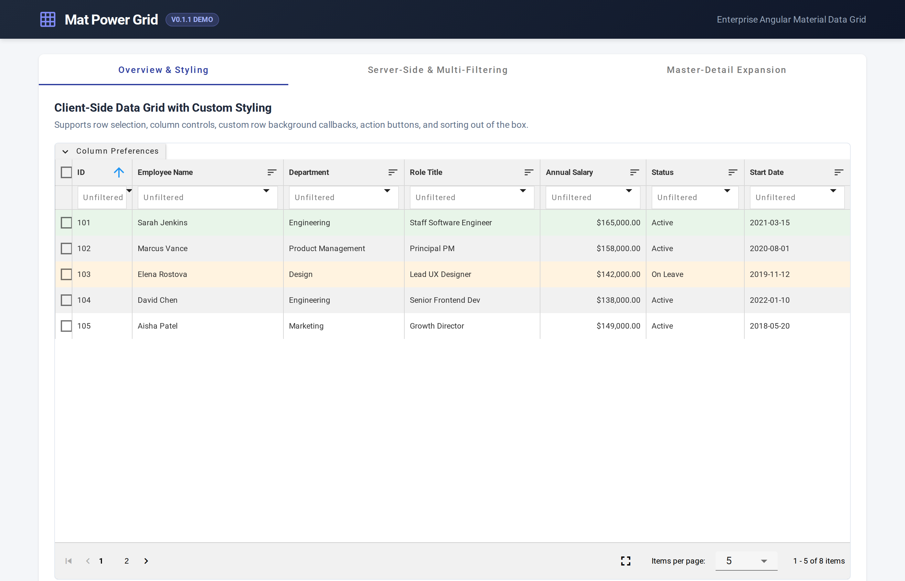
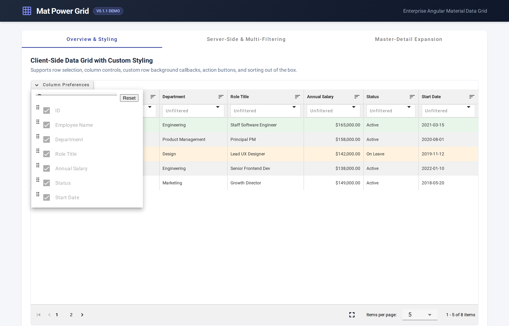
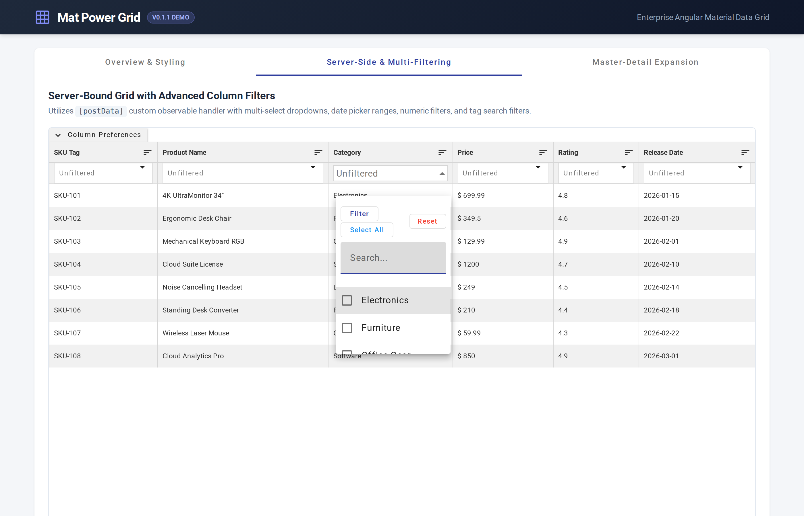
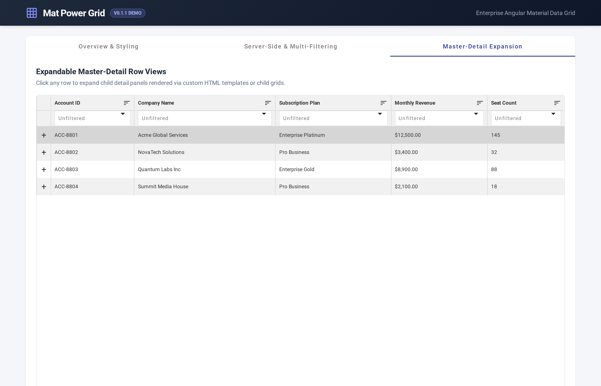

# Mat Power Grid Detailed Documentation Guide

Welcome to the comprehensive technical documentation for **Mat Power Grid**.

---

## Table of Contents
1. [Architecture Overview](#architecture-overview)
2. [Demo Showcase & Visual Examples](#demo-showcase--visual-examples)
3. [Component API Reference (`<mpg-grid>`)](#component-api-reference-mpg-grid)
4. [Grid Heading Configuration (`GridHeading`)](#grid-heading-configuration-gridheading)
5. [Filter Types & Behavior](#filter-types--behavior)
6. [Server-Side Integration Payload (`GridRequest`)](#server-side-integration-payload-gridrequest)
7. [Master-Detail Expansion](#master-detail-expansion)
8. [Theming & MDC CSS Utilities](#theming--mdc-css-utilities)
9. [Running the Demo Application](#running-the-demo-application)

---

## Architecture Overview

Mat Power Grid is designed for Angular 20+ / 21+ and provides a complete data grid solution built on Angular Material MDC components and CDK Virtual Scroll.

Key architectural concepts:
- **Standalone/Module Compatible:** Exposed via `MatPowerGridModule`.
- **Flexible Data Handling:** Standard HTTP endpoint requests via `url` or direct reactive observables via `postData`.
- **MDC Target Safety:** Includes isolated styling rules in `mat-power-grid-utilities.scss` to ensure popups, overlays, and touch targets render without glitches.

---

## Demo Showcase & Visual Examples

### Overview & Column Customization
The main grid view supports client-side or server-side pagination, sorting, dynamic row background highlights, action buttons, and selection checkboxes.



### Column Preferences & Re-ordering Panel
Users can open the Column Control panel to toggle column visibility and drag-and-drop columns into any custom order.



### Advanced Server Filtering & Data Fetching
Server-side mode supports rich filter popups including date ranges, numeric ranges, tag matchers, and dropdowns.



### Master-Detail Expansion
Rows can be expanded to display custom sub-templates, child grids, or detailed key-value metadata.



---

## Component API Reference (`<mpg-grid>`)

### Inputs (`@Input()`)

| Property | Type | Default | Description |
| :--- | :--- | :--- | :--- |
| `headings` | `GridHeading[]` | `[]` | Array of column definitions. |
| `url` | `string` | `''` | HTTP endpoint URL for fetching grid data. |
| `serverSidePagination` | `boolean` | `false` | Enable server-side pagination, sorting, and filtering. |
| `postData` | `((param: any) => Observable<any>)` | `undefined` | Custom callback function for data fetching (bypasses default POST url). |
| `entity` | `any` | `null` | Additional payload parameters passed with every request. |
| `pageSize` | `number` | `100` | Initial records per page. |
| `pageSizes` | `number[]` | `[50, 100, 250, 500, 1000]` | Available page size selections in pagination component. |
| `selection` | `boolean` | `false` | Enable checkbox row selection. |
| `columnControl` | `boolean` | `false` | Enable column visibility and re-ordering controls. |
| `expandable` | `boolean` | `false` | Enable Master-Detail row expansion. |
| `expandableConfig` | `GridMasterDetailConfig` | `{...}` | Configuration for expandable row template or child grid. |
| `rowHeight` | `number` | `40` | Height of each row in pixels for CDK virtual scrolling strategy. |
| `rowBackgroundField` | `string` | `undefined` | Item property key specifying inline row background color. |
| `rowBackgroundCallback` | `(item: any, index: number) => string` | `undefined` | Callback returning background color string for row styling. |

### Outputs (`@Output()`)

| Event | Type Payload | Description |
| :--- | :--- | :--- |
| `responseEmit` | `GridResponse` | Emitted whenever new grid data is loaded. |
| `requestBodyEmit` | `GridRequest` | Emitted immediately before sending data fetch request. |
| `selectionEmit` | `any[]` | Emitted when selected rows change. |
| `buttonClickEmit` | `GridButtonClick` | Emitted when a custom row button or clickable link is clicked. |
| `filtersChangedEmit` | `GridFilterItem[]` | Emitted when active filters change. |
| `sortChangedEmit` | `GridSortItem` | Emitted when active sort column or direction changes. |

---

## Grid Heading Configuration (`GridHeading`)

Each object in the `headings` array defines a grid column:

```typescript
export interface GridHeading {
  fieldName: string;         // Unique property name in data row object
  display: string;           // Column header display title
  type?: 'string' | 'number' | 'date' | 'currency' | 'tag' | 'multi-select';
  width?: string;            // e.g. '150px' or '20%'
  sort?: 'asc' | 'desc' | null;
  disableSorting?: boolean;  // Disable column sorting
  disableFiltering?: boolean; // Disable column filter dropdown
  dateFormat?: string;       // Angular DatePipe format string
  prefix?: string;           // Prefix string for values (e.g. '$')
  textAlign?: 'left' | 'center' | 'right';
  show?: boolean;            // Column visibility toggle
}
```

---

## Filter Types & Behavior

Mat Power Grid includes dedicated filter components per data type:
- **String Filter:** `contains`, `eq`, `neq`, `startswith`, `endswith`.
- **Number Filter:** `between` (min-max range), `eq`, `neq`, `greaterthan`, `lessthan`, `greaterorequal`, `lessthanorequal`.
- **Date Filter:** `betweendates` date picker range and `blank`.
- **Tag Filter:** Supports adding multiple tags or pasting comma-separated/newline lists up to 5,000 items.
- **Multi-Select Dropdown Filter:** Option selection with select-all and search capabilities.

---

## Server-Side Integration Payload (`GridRequest`)

When `serverSidePagination` is enabled, the grid posts a request with the following structure:

```json
{
  "entity": { ... },
  "page": 1,
  "perPage": 100,
  "sort": "asc",
  "sortField": "customerName",
  "filters": [
    {
      "field": "status",
      "operator": "eq",
      "value": "ACTIVE"
    }
  ]
}
```

---

## Master-Detail Expansion

To enable expandable rows, set `[expandable]="true"` and configure `[expandableConfig]`:

```html
<mpg-grid
  [headings]="headings"
  [url]="url"
  [expandable]="true"
  [expandableConfig]="expandableConfig">
</mpg-grid>
```

```typescript
expandableConfig = {
  type: 'html', // or 'child-grid'
  template: '<p>Row detail summary for <strong>{{customerName}}</strong></p>'
};
```

---

## Theming & MDC CSS Utilities

Import `mat-power-grid-utilities.scss` into your global styles or main SCSS file to apply MDC menu sizing and layout overrides:

```scss
@import 'mat-power-grid/src/lib/mat-power-grid-utilities.scss';
```

---

## Running the Demo Application

To launch and test the demo project locally in your workspace:

```bash
# Build the library package
yarn lib:build

# Launch the demo server
yarn start
```
Then visit `http://localhost:4200/`.
